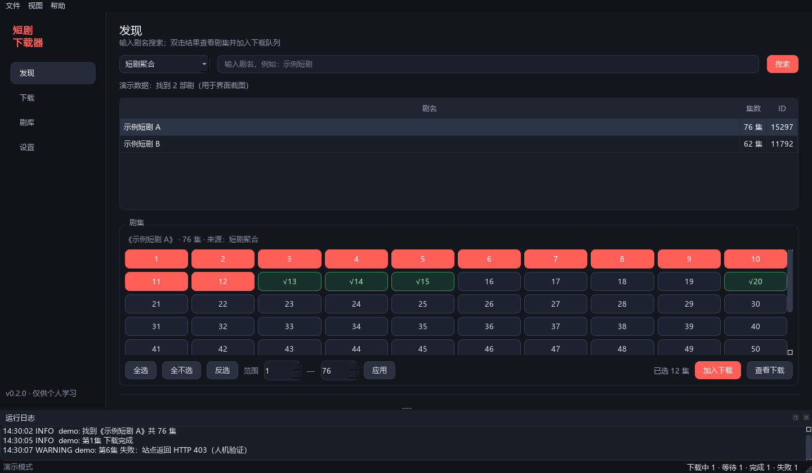
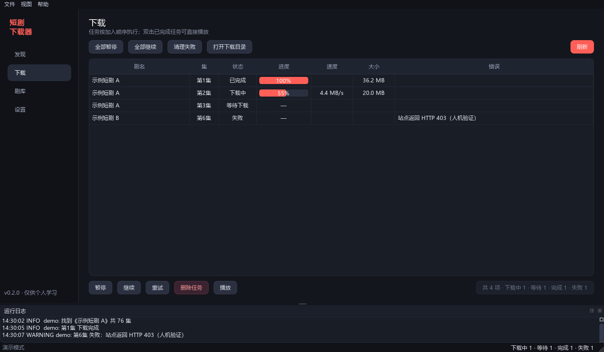
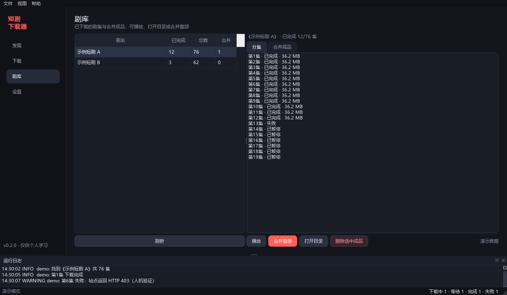
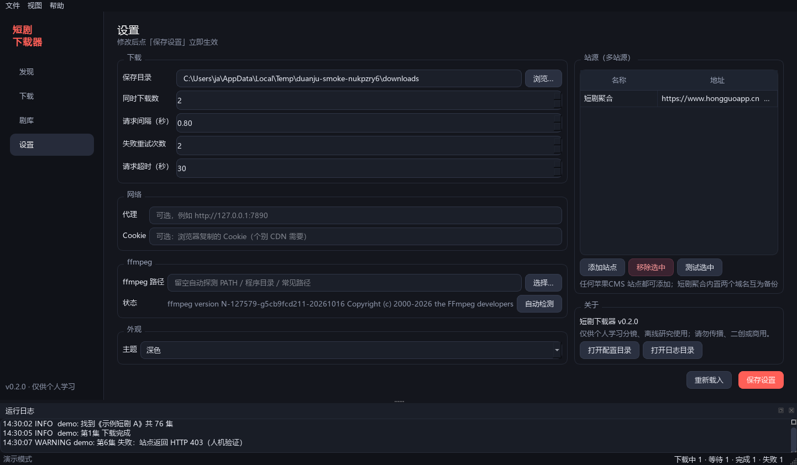

# 下载器 · Windows 桌面版

当前版本：**0.1.0**（唯一版本来源：`duanju/version.py` 的 `VERSION`）

基于 PySide6 的 Windows 桌面应用：
**搜索 → 选集 → 批量下载 → 断点恢复 → 整部合并 → 内置播放**，全部在本机完成。

> ⚠️ **仅供个人学习分镜、离线研究使用。** 下载内容版权归原作者/平台所有，请勿传播、二创搬运或商用。
> 批量抓取可能违反平台服务条款，请控制频率、自行承担风险。







## 功能

| 模块 | 能力 |
|------|------|
| 发现 | 关键词搜索（优先站点的 JSON 联想接口，HTML 搜索页兜底）、双击查看剧集 |
| 选集 | 剧集网格、全选 / 反选 / 区间选择、只下指定集；**选中红色、未选中深色、已下载绿色 √** |
| 下载 | 队列 + 并发（1–6）、实时进度 / 速度 / 大小、暂停 / 继续 / 重试 / 删除、启动恢复 |
| 剧库 | 按剧查看已完成分集、播放、打开所在目录、删除分集 |
| 合并 | 把整部剧的 mp4 无损拼接为一个文件（失败自动回退转码），带进度与取消 |
| 播放 | 内置播放器（libmpv 强兼容解码引擎）：上一集 / 下一集、进度拖动、音量、全屏、键盘快捷键 |
| 设置 | 保存目录、并发、请求间隔、重试、超时、代理、Cookie、ffmpeg 路径、主题 |
| 打包 | PyInstaller onedir，双击 exe 运行，可压缩分发给他人 |

## 环境要求

- Windows 10 / 11 x64
- Python 3.10+（本项目在 3.12 上开发验证）
- **ffmpeg / ffprobe**：用于下载、探测与合并
  - 已在 PATH 里：自动使用
  - 或把 `ffmpeg.exe`、`ffprobe.exe` 放到程序目录的 `tools\` 下
  - 或在「设置 → ffmpeg 路径」里手动指定
- **libmpv（mpv-2.dll）**：内置播放器基于 libmpv，需要 `mpv-2.dll`
  - 放在项目根目录；打包时由 `duanju.spec` 一并打入 `dist\DuanjuDownloader\_internal\`
  - 获取方式：从 [mpv-winbuild-cmake-releases](https://github.com/shinchiro/mpv-winbuild-cmake/releases) 下载
    `mpv-dev-x86_64-*.7z`，解压得到 `libmpv-2.dll` 后**重命名为 `mpv-2.dll`**
  - 许可说明：libmpv 默认 **GPLv2+**；如项目整体需要宽松许可，可改用 `mpv-dev-lgpl` 提供的 LGPL 构建
  - 该 DLL 不随仓库分发（原因见「打包分发」）

## 安装与运行

```powershell
# 1) 安装依赖（建议加国内镜像）
python -m pip install -r requirements.txt -i https://mirrors.aliyun.com/pypi/simple

# 2) 启动
python app.py
# 或双击 run.bat
```

> 网络差/需要离线安装时：`python scripts/fetch_wheels.py --wheelhouse wheelhouse PySide6-Essentials PySide6-Addons requests`
> 然后 `python -m pip install --user --no-index --find-links wheelhouse -r requirements.txt`。

首次启动会在 `%APPDATA%\DuanjuDownloader\` 创建配置、数据库与日志目录。

## 打包分发

```powershell
# 安装打包工具（只需一次）
python -m pip install -r requirements-dev.txt -i https://mirrors.aliyun.com/pypi/simple

# 一键打包 + 冒烟验证
powershell -ExecutionPolicy Bypass -File scripts\build.ps1
```

产物在 `dist\DuanjuDownloader\`（双击 `DuanjuDownloader.exe` 运行）与
`dist\DuanjuDownloader-<version>-win64.zip`（约 96 MB，可直接分发）。
脚本自动从 `duanju/version.py` 读取版本号命名 zip，无需手动改名。
**ffmpeg 不随包分发**（体积 140MB+ 且涉及 GPL 许可）：对方需要把 ffmpeg 加入 PATH，
或在设置里指定路径，或把 `ffmpeg.exe` / `ffprobe.exe` 放进程序目录的 `tools\`。

**mpv-2.dll 同样不随包分发，且不纳入 GitHub 源码仓库**：该单文件约 **115MB**，超过 GitHub
单文件 **100MB** 的硬限制，无法直接提交。因此打包前**必须手动**把 `mpv-2.dll` 放入项目根目录，
`duanju.spec` 已配置将它一并打入产物（PyInstaller 6 的 onedir 模式下落在 `_internal\` 目录）。注意：主窗口在导入阶段即加载
播放器模块，**缺少该 DLL 时程序会直接启动失败**（报 `Cannot find mpv-1.dll, mpv-2.dll or libmpv-2.dll`），
不是仅播放功能不可用。

## 版本与发版

版本号只有一处定义：`duanju/version.py` 的 `VERSION`，其余环节全部从它派生。

| 环节 | 表现 |
| --- | --- |
| 运行时自报 | `python app.py --version` 与 `DuanjuDownloader.exe --version` 输出同一个值 |
| exe 属性 | `duanju.spec` 调用 `scripts/make_version_info.py` 生成版本资源，右键 exe → 属性 → 详细信息可见文件版本 / 产品版本 |
| 分发包 | `scripts/build.ps1` 生成 `dist\DuanjuDownloader-<version>-win64.zip` |
| 源码标签 | `git tag -a v<version>`，标签名与 `VERSION` 同名 |

发版四步：

```powershell
# 1) 改版本号并提交（编辑 duanju/version.py 的 VERSION）
git add duanju/version.py
git commit -m "chore: bump version to x.y.z"

# 2) 打同名注释标签
git tag -a vx.y.z -m "vx.y.z: 一句话说明"

# 3) 打包（自动产出同名 zip，并用 exe --version 交叉校验）
powershell -ExecutionPolicy Bypass -File scripts\build.ps1

# 4) 推送分支与标签
git push origin main
git push origin vx.y.z
```

版本沿革：

| 标签 | 内容 |
| --- | --- |
| `v0.1.0` | 当前版本：libmpv 播放引擎、下载管线与界面重构、版本号工程化（仓库唯一版本线） |

## 使用流程

1. **发现**：选择站源 → 输入剧名 → 搜索 → 双击结果。
2. **选集**：默认全选；可「范围」只选第 5–10 集；点「加入下载」。
3. **下载**：在下载页看进度；可暂停 / 继续 / 删除；关掉应用再打开，未完成任务会变成「已暂停」，点继续即可。
4. **剧库**：查看已完成分集；可播放、打开目录；点「合并整部」生成 `剧名_全集.mp4`。
5. **播放**：双击已完成分集或合并成品，进入内置播放器（空格暂停、←/→ 快退快进、F 全屏、Esc 退出）。

## 目录与数据

| 内容 | 位置 |
|------|------|
| 配置 | `%APPDATA%\DuanjuDownloader\config.json` |
| 数据库（任务/剧库/合并记录） | `%APPDATA%\DuanjuDownloader\app.db` |
| 日志 | `%APPDATA%\DuanjuDownloader\logs\app.log`（5MB 轮转，保留 3 份） |
| 视频 | 设置里的保存目录（默认 `%USERPROFILE%\Videos\DuanjuDownloader`） |

视频按剧名建子目录，文件名为 `第01集.mp4`；合并成品为 `剧名_全集.mp4`。

## 配置项

| 键 | 默认 | 说明 |
|----|------|------|
| `download_dir` | 视频/DuanjuDownloader | 保存根目录 |
| `concurrency` | 2 | 同时下载集数（1–6） |
| `interval` | 0.8 | 同域名请求最小间隔（秒），防封 |
| `retries` | 2 | 单集失败重试次数 |
| `timeout` | 30 | 请求超时（秒） |
| `proxy` | 空 | 例如 `http://127.0.0.1:7890` |
| `cookie` | 空 | 浏览器复制的 Cookie，个别 CDN 需要 |
| `ffmpeg_path` | 空 | 留空自动探测 |
| `theme` | dark | `dark` / `light` |
| `sources` | 短剧聚合 | 站源列表，可在设置页增删 |

## 开发与验证

```powershell
# 单元测试（解析 / 数据库 / 任务状态机）
python -m unittest discover -s tests -t . -v

# 下载 + 合并冒烟（本机生成测试 HLS，不访问真实站源）
python scripts\smoke_download.py

# 端到端冒烟（本地假站源 → 搜索/详情/下载/合并全链路，完全离线）
python scripts\smoke_e2e.py

# 站源网络冒烟（真实访问搜索 / 详情 / 取流，不下载视频）
python scripts\smoke_net.py

# 界面离屏截图（开发自检）
python app.py --smoke-shot .smoke\shots

# 运行环境诊断（完整性级别 / 数据目录 / ffmpeg）
python app.py --diagnose

# 一键离线验证
powershell -ExecutionPolicy Bypass -File scripts\verify.ps1
```

### 架构

```
┌─────────────────────── PySide6 UI（ui/） ───────────────────────┐
│ 主窗口 / 发现 / 下载 / 剧库 / 设置 / 播放器 / 日志面板           │
│   Bridge（QObject 信号）：后台线程 → 主线程，进度/任务/日志事件   │
└──────────────────────────────┬──────────────────────────────────┘
                               │ 仅调用 Service（无 UI 依赖）
┌──────────────────────────────▼──────────────────────────────────┐
│ Service（duanju/service.py）：搜索 / 详情 / 入队 / 合并 / 设置  │
│  ├─ JobManager：队列、并发、状态机、暂停/继续/删除、进度持久化    │
│  ├─ SourceRegistry + MacCmsSource：搜索/详情/取流（多站源）       │
│  ├─ HttpClient：重试、限速、代理、Cookie、人机验证识别            │
│  ├─ FFmpeg：拉流、进度解析、取消、完整性校验                     │
│  ├─ merge_episodes：ffmpeg concat 无损合并（失败回退转码）        │
│  └─ Database：SQLite（剧库 / 任务 / 合并成品）                    │
└─────────────────────────────────────────────────────────────────┘
```

设计约定：

- `ui/` 可以 import `duanju/`，`duanju/` **绝不** import `ui/`；
- 所有耗时操作经 `Bridge.run` / `run_with_progress` 放到线程，UI 只处理信号；
- 任务状态：`queued → downloading → completed / failed / paused`，启动时把未完成任务恢复为 paused；
- 文件先写 `*.part.mp4`，校验通过再原子改名，避免半截文件被当成完成。

### 目录结构

```
duanju-gui/
├─ app.py                 # 入口
├─ duanju/               # 核心（无 UI 依赖）
│  ├─ config.py net.py sources.py models.py errors.py util.py
│  ├─ db.py jobs.py download.py merge.py service.py logging_setup.py
├─ ui/                    # PySide6 界面
│  ├─ bridge.py theme.py widgets.py
│  ├─ main_window.py search_page.py downloads_page.py
│  ├─ library_page.py settings_page.py player_window.py
├─ tests/                 # unittest 单元测试
├─ scripts/               # 冒烟、图标、打包（build.ps1）、版本资源（make_version_info.py）、验证
├─ assets/                # 图标与截图
├─ duanju.spec           # PyInstaller 配置
└─ requirements*.txt
```

## 常见问题

**启动报 `[WinError 5] 拒绝访问 ...AppData\\Roaming\\DuanjuDownloader`**
：exe 被以 **Low Integrity（低完整性）** 启动，典型原因是把程序放在**沙箱/受控目录**里运行
（例如本项目的交付工作区 `D:\tear\harness`）。
请把整个文件夹解压/复制到**桌面或普通目录**（如 `C:\Users\<你>\Desktop`、`D:\Tools`）后再运行。
新版程序会自动回退到 `LocalLow` 或临时目录并弹窗说明；也可用
`DuanjuDownloader.exe --diagnose` 查看完整性级别与数据目录。

**搜索返回 403 / 人机验证**
：站点对机房 IP 或高频请求敏感。换网络、降低频率，或直接在浏览器搜索后拿 id；本项目已优先使用不受搜索页 WAF 影响的 JSON 接口。

**提示「未找到 ffmpeg」**
：安装 ffmpeg 并加入 PATH，或放到程序目录 `tools\`，或在设置里选择 `ffmpeg.exe`。

**启动即报 libmpv / mpv-2.dll 错误**
：典型现象是启动日志里出现 `mpv-2.dll` **DLL 预加载失败**，或直接抛
`OSError: Cannot find mpv-1.dll, mpv-2.dll or libmpv-2.dll`、`ModuleNotFoundError: No module named 'mpv'`。
由于主窗口在导入阶段就加载播放器模块，这类错误会导致**程序完全无法启动**，需先解决：
1. 确认 `mpv-2.dll` 位于项目根目录（打包版则与 `DuanjuDownloader.exe` 同级），文件名优先使用 `mpv-2.dll`；
2. 确认已安装 Python 绑定：`python -m pip install "python-mpv>=1.0.8"`（PowerShell 中引号不可省，否则 `>` 会被当作重定向；该包已在 `requirements.txt` 中，正常安装依赖即会带上）。

**下载失败 / 中途停止**
：看任务行的错误列和日志。常见原因：地址过期（重试会自动重新解析）、被 CDN 限流（调大间隔、减少并发）、网络中断（点继续）。

**合并失败**
：分集来自不同清晰度/编码时无损合并会失败，程序会自动回退转码（较慢）；仍失败可查看日志。

**杀毒软件误报**
：PyInstaller 打包的未签名 exe 常见。可自行用代码签名证书签名，或从源码运行。

**换电脑怎么迁移**
：复制视频目录 + `%APPDATA%\DuanjuDownloader\` 下的 `config.json`、`app.db`；路径变化时在设置里改保存目录。

## 已知限制

- 仅支持苹果CMS 类站点（`player_xxx` + m3u8/mp4）；不处理 DRM、付费、直播。
- 内置播放器基于 libmpv，**自带解码器**，不依赖系统解码器（Windows Media Foundation），因此不受系统组件缺失或损坏影响；但极冷门的编码/封装仍可能无法播放，可改用系统播放器。
- 暂停是「中断当前集」而非分片续传；重新继续会从这一集重新下载。
- 未做自动更新、托盘常驻、任务定时。

## 源码仓库

- GitHub（公开）：https://github.com/ftpc/duanju

## 合规声明

- 本工具仅用于个人学习分镜、离线研究；**请勿传播下载内容、二次剪辑搬运或商用**。
- 请遵守目标网站的服务条款与当地法律；由使用产生的风险由使用者自行承担。
- 项目不包含任何绕过付费、VIP 或登录限制的功能。
